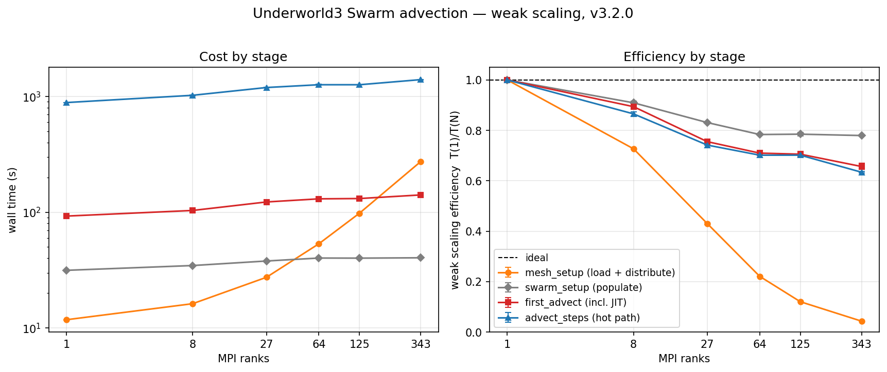

# Underworld3 weak scaling

How the current [Underworld3](https://github.com/underworldcode/underworld3) release
scales on Gadi (NCI), one figure per model. Protocol: `NTASKS = i³`, `res = BASE × i`, so
every rank holds the same work at every point, the ideal curve is flat, and efficiency is
T(first point)/T(N). Mesh load and distribution is drawn separately from the solve because
it dominates at scale for every model.

**Current release: UW3 v3.2.0** · PETSc 3.25.0 · `underworld3-v3.2.0-20261104-254152221812.sif`
· benchmark v2 · 1–1000 ranks · 2 replicates per point · November 2026.
What changed since v3.1.0: [investigations/v3.2.0-vs-v3.1.0.md](investigations/v3.2.0-vs-v3.1.0.md).
The full characterisation, with the controls behind each claim: [investigations/](investigations/README.md).

## Poisson


*Poisson equation with a manufactured solution (sin πx sin πy sin πz), Dirichlet walls, degree-2 elements on a BASE=24 unstructured tetrahedral box, Krylov + algebraic multigrid (GAMG); fixed work: unreachable tolerance, 10 KSP iterations per solve. v3.2.0, 2 replicates per point; bars span the replicate min–max range; 2 cold-JIT replicates excluded.*

Fixed work: 10 KSP iterations per solve at every rank count. The solve holds efficiency
**0.77 at 1000 ranks** (7.6 → 9.8 s) and the first solve, which carries setup and JIT, 0.45.
Mesh load and distribution is the cost that grows: 12 s serial, **918 s at 1000 ranks**,
94× the solve, of which `DMPlexDistribute` is 603 s. Since v3.1.0: solver 4–12% slower
(PETSc-default GAMG, upstream #584), everything else unchanged.

## Stokes


*Isoviscous incompressible Stokes in a spherical shell (r = 1.22–2.22), no-slip walls, radial body force, Q2–P1 elements on a BASE=5 unstructured mesh, Newton with a Schur-complement fieldsplit and GAMG on the velocity block; fixed tolerance 1e-8, every point converged; from 8 ranks, since the serial point measures node occupancy, not scaling. v3.2.0, 2 replicates per point; bars span the replicate min–max range.*

Fixed tolerance 1e-8 on a spherical shell, every point converged; shown from 8 ranks because
the serial point measures node occupancy, not scaling. The solve holds **0.58 at 1000 ranks**
against 8 (194 → 334 s), most of the loss inside the first node (0.70 at 27 ranks) and little
after it. Mesh: 5 → 280 s. Since v3.1.0: unchanged within ±6%.

## Advection–diffusion


*Advection–diffusion of a scalar (initial field sin πx sin πy sin πz, unit diffusivity) in a prescribed divergence-free solid-body rotation, semi-Lagrangian characteristics with nodal projection (SLCN), degree-2 elements, Dirichlet walls, BASE=24 box; 10 timesteps at CFL 0.5, fixed work. v3.2.0, 2 replicates per point; bars span the replicate min–max range; 1 cold-JIT replicate excluded.*

Semi-Lagrangian scheme, 10 timesteps, fixed work. **0.39 at 1000 ranks** (821 → 2105 s per
10 steps). The Newton/Krylov part is flat; the growth is the off-rank velocity evaluation
along the characteristics (`global_evaluate`), the part of the code that does not yet scale.
Since v3.1.0: twice as fast from 8 ranks up, because that evaluation got cheaper.

## Checkpoint I/O


*Three fields set from expressions on a BASE=24 box (velocity Q2, pressure and temperature P1), written and read back two ways: the visualisation/remap format (write_timestep / read_timestep) and the PETSc-native reload (petsc_reload / read_checkpoint); no solve. v3.2.0, 2–3 replicates per point; bars span the replicate min–max range.*

Three fields (velocity, pressure, temperature) written and read two ways, no solve. The
remap writer (`write_timestep`) degrades gracefully, 4 → 77 s to 1000 ranks; the remap
reader (`read_timestep`, a coordinate-remap reader) and the native writer (`petsc_reload`)
collapse, 1 → 224 s and 2 → 448 s; the native reader (`read_checkpoint`) is cheap and
climbs late, 1 → 51 s. Since v3.1.0: unchanged within I/O noise.

**Correctness caveat.** The native reload returns the right values in serial and the wrong
ones at every parallel rank count in this harness (round-trip error equal to each field's
full range, in both releases); the remap reader is exact everywhere. Whether this is a usage
error in the benchmark or an UW3 bug is not yet settled (see `upstream/`), so
`io_read_native` times a path whose result is not verified.

## uw.function.evaluate


*uw.function.evaluate of a P1 field (T = 1 − z) at ~12k points per rank on a BASE=24 box: at the variable's own nodes, where no search is needed, and half a cell into the cell interiors, where the owning cell must be found first; same runs as the checkpoint campaign. v3.2.0, 2–3 replicates per point; bars span the replicate min–max range.*

About 12k points per rank of a P1 field. At the variable's own nodes evaluation holds 0.75
at 1000 ranks (0.2 → 0.3 s); half a cell into the cell interiors, where the owning cell must
be found first, 0.64 (0.3 → 0.5 s). Accuracy: exact in serial (1e-5), first-order in parallel
(2e-2 at 8 ranks to 5e-3 at 1000). Since v3.1.0: off-node 14–18% faster; parallel accuracy
~1.5× worse.

## Swarm advection



*Dense particle swarm (20 per tetrahedron, 1.3 M per rank) on a BASE=24 box, advected with UW3's own `Swarm.advection` (RK2 midpoint, `global_evaluate` for the velocity, `migrate` after each step) through a steady divergence-free 3D cellular flow carried on a degree-2 velocity field, zero normal flow at the walls; 10 steps of half a cell, particles migrated between ranks after each; no solve. v3.2.0, 2–3 replicates per point; bars span the replicate min–max range; 1 replicate excluded as a slow-node outlier (reason in `runs.csv`).*

New this round. 1.3 M particles per rank, 20 per tetrahedron, ten steps of half a cell
through a steady 3D cellular flow on a degree-2 velocity field, each step UW3's own
`Swarm.advection` (RK2 midpoint scheme, velocity sampled with `global_evaluate`, then
`migrate`); no solve, nothing reimplemented in the benchmark. The hot path holds
**0.63 at 343 ranks** (88 → 140 s per step; 1000 ranks not run yet), with the velocity
evaluation at particle positions (`global_evaluate`: KDTree search, RBF interpolation,
collective exchange) as the whole cost and migration at ~3%. Populate is flat.

**Caveat.** Particles are lost in parallel and never in serial: 0.013% of the swarm at 8
ranks rising to 0.025% at 343, identical between replicates. The flow has zero normal
velocity on every wall, so these are particles that crossed a subdomain seam and were not
claimed by their new owner (`migrate(delete_lost_points=True)`); a usage check is pending
before this goes upstream.

## Reproducing

```bash
vi params.sh                                  # campaign: models, JOBS, container
bash scaling_test_job_launcher.sh             # one PBS job per JOBS × RUN_INDICES
bash scaling_test_job_launcher.sh params-stokes.sh       # and params-checkpoint.sh, params-swarm.sh
python3 analysis/export_data.py --round <label> --uw3-version ... --campaigns ...
python3 analysis/fig_release.py               # figures above (--mode current) and the comparison set
python3 analysis/compare_releases.py          # the attribution tables
```

Raw PETSc logs (GBs) stay on `/scratch` and are gitignored; `data/<round>/` is the committed
reduction every figure reads. Replicates that ran on a cold JIT cache, or on a demonstrably
slow node, are flagged in `runs.csv` with the reason and left out of the means. Campaign
details, measurement pitfalls and the archive procedure:
[investigations/README.md](investigations/README.md#running-a-campaign).

## Repository map

- `*-scaling.py` — the model scripts (Poisson, Stokes, advection–diffusion, checkpoint I/O
  with `uw.function.evaluate`, dense swarm advection; `ns` and `vep` are not yet in a
  round). `gadi_container_go.sh` passes their flags.
- `params.sh` and the `params-<model>.sh` layers, `scaling_test_job_launcher.sh`,
  `generate_meshes{.py,_pbs.sh}` — campaign launch and the mesh cache.
- `analysis/` — export, figures, attribution. `figdata.py` is the one reader.
- `data/<round>/` — committed reductions. `investigations/` — the per-release
  characterisation and the release-over-release comparison. `reports/` — frozen rounds.
- `upstream/` — issue drafts and reproducers. `legacy/` — pre-campaign timing scripts.
- [CHANGELOG.md](CHANGELOG.md) — conclusions that were revised, and why.
