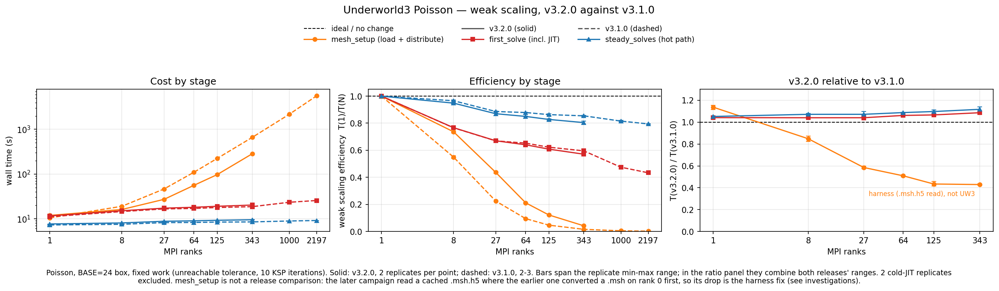
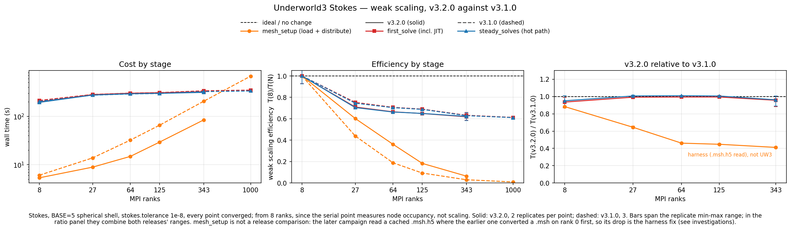
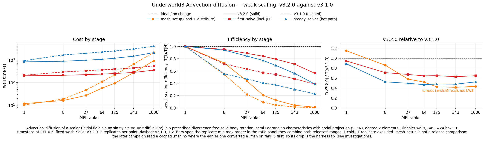

# Underworld3 weak scaling

Release-over-release weak-scaling performance of
[Underworld3](https://github.com/underworldcode/underworld3) on Gadi (NCI). Every release
runs the same three models under the same protocol — `NTASKS = i³`, `res = BASE × i`, so
work per rank is constant and the ideal curve is flat. The full characterisation of a
release, with the controls behind each claim, is in [investigations/](investigations/README.md).

| round | UW3 | PETSc | container | benchmark | ranks | what |
|---|---|---|---|---|---|---|
| `2026-08_uw3-v3.1.0` | v3.1.0 | 3.25.0 | `underworld3-gadi_v3.1.0.sif` | v1 | 1 – 2197 | full characterisation, 2–3 replicates |
| `2026-11_uw3-v3.2.0` | v3.2.0 | 3.25.0 | `underworld3-v3.2.0-20261104-254152221812.sif` | v2 | 1 – 343 | release check, 2 replicates |

Benchmark v2 adds a timed barrier after every stage and reads the mesh from `.msh.h5`. Its
stage times compare with v1's because every v1 stage was verified to end on a collective
(per-rank spread ≤ 0.27 s in each campaign's largest run); the `.msh.h5` read is the one
protocol change that moves a number, and it moves `mesh_setup` only.

## Poisson



**Solver 4–12% slower, growing with rank count.** v3.2.0 dropped UW3's own GAMG settings
(aggressive coarsening, repartitioning, additive cycle, two smoothing sweeps, three smoother
iterations) and runs PETSc's defaults (upstream #584). Iteration counts are identical; each
`PCApply` costs 2.2× more at 343 ranks and `PCSetUp` 25% more, assembly is unchanged at
scale. In absolute terms 9 s of a 316 s run at 343 ranks.

## Stokes



**Unchanged, within ±6%.** Same Newton and outer Krylov counts, inner Schur solves equal to
three digits. v3.2.0's `preconditioner="auto"` falls back from geometric multigrid to GAMG
when there is no mesh hierarchy (#625), recorded in every run — which is what v3.1.0 ran
anyway. v3.2.0 also auto-detects a warm start, so `steady_solves` carries one extra cheap
SNES solve (~2 s); the next benchmark version pins it with `zero_init_guess=True`.

## Advection–diffusion



**Twice as fast from 8 ranks up.** The SNES stack is unchanged; `global_evaluate`, the
semi-Lagrangian off-rank evaluation, fell from 2341 to 769 s at 343 ranks, with
`KDTree.query` calls 4960 → 2144. The advection step is still the part that does not scale
(see investigations), at a third of the cost.

## v3.2.0 against v3.1.0

`mesh_setup` fell 41–58% from 27 ranks in every model. That is the harness, not the release:
the v3.2.0 campaign read a cached `.msh.h5` where v3.1.0 converted the `.msh` on rank 0
first. What remains at 343 ranks (283 s) is `DMPlexDistribute`, 178 s in both releases and
now the dominant mesh cost. Event-level attribution for every stage:
[investigations/release_v3.2.0.md](investigations/release_v3.2.0.md).

Cold-JIT replicates — a new container's first runs compile every expression, 2.4–5.2 s on
top of the first stages — are flagged in `runs.csv` and left out of the means: four in the
v3.2.0 round, none in v3.1.0.

## Reproducing

```bash
vi params.sh                                  # campaign: models, JOBS, container
bash scaling_test_job_launcher.sh             # one PBS job per JOBS × RUN_INDICES
bash scaling_test_job_launcher.sh params-stokes.sh       # and params-checkpoint.sh, params-swarm.sh
python3 analysis/export_data.py --round <label> --uw3-version ... --campaigns ...
python3 analysis/fig_release.py               # the figures above, and the table
python3 analysis/compare_releases.py          # the attribution tables
```

Raw PETSc logs (GBs) stay on `/scratch` and are gitignored; `data/<round>/` is the committed
reduction every figure reads. Campaign details, measurement pitfalls and the archive
procedure: [investigations/README.md](investigations/README.md#running-a-campaign).

## Repository map

- `*-scaling.py` — the model scripts (Poisson, Stokes, advection–diffusion, checkpoint I/O
  with `uw.function.evaluate`, dense swarm advection; `ns` and `vep` are not yet in a
  round). `gadi_container_go.sh` passes their flags.
- `params.sh` and the `params-<model>.sh` layers, `scaling_test_job_launcher.sh`,
  `generate_meshes{.py,_pbs.sh}` — campaign launch and the mesh cache.
- `analysis/` — export, figures, attribution. `figdata.py` is the one reader.
- `data/<round>/` — committed reductions. `investigations/` — the per-release
  characterisation. `reports/` — frozen rounds.
- `upstream/` — issue drafts and reproducers. `legacy/` — pre-campaign timing scripts.
- [CHANGELOG.md](CHANGELOG.md) — conclusions that were revised, and why.
