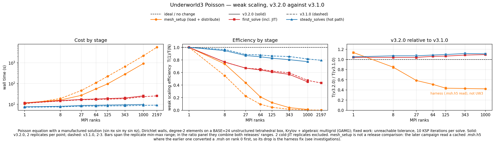
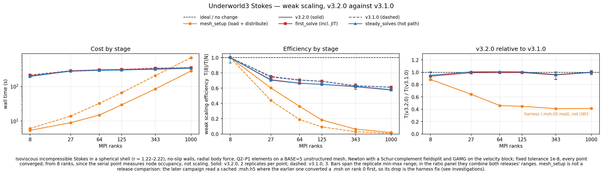
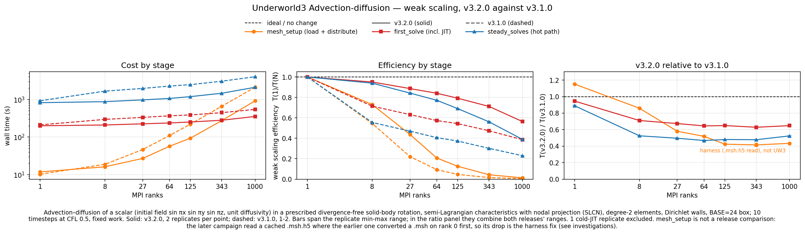
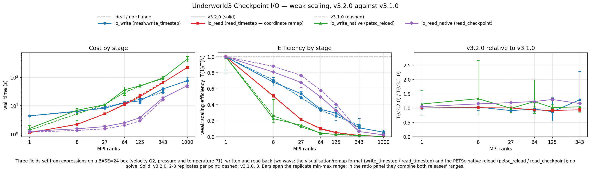
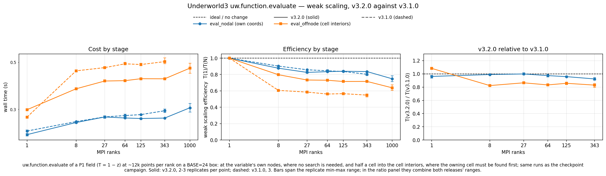

# v3.2.0 against v3.1.0

Same models, same protocol, same Gadi placement. v3.1.0 was characterised in August 2026
(benchmark v1, 1–2197 ranks, [investigations/README.md](README.md)); v3.2.0 was run in
November 2026 (benchmark v2, 1–1000 ranks, 2 replicates per point). Benchmark v2 adds a
timed barrier after every stage and reads the mesh from `.msh.h5`. Its stage times compare
with v1's because every v1 stage was verified to end on a collective (per-rank spread
≤ 0.27 s in each campaign's largest run); the `.msh.h5` read is the one protocol change
that moves a number, and it moves `mesh_setup` only.

Figures: `python3 analysis/fig_release.py --mode compare`. Tables:
`python3 analysis/compare_releases.py`. Solid is v3.2.0, dashed v3.1.0; the third panel is
the ratio, the only form in which a 10% change is readable.

## Poisson

**Solver 4–12% slower, growing with rank count, 10–11% at 1000 ranks.** v3.2.0 dropped UW3's own GAMG settings
(aggressive coarsening, repartitioning, additive cycle, two smoothing sweeps, three smoother
iterations) and runs PETSc's defaults (upstream #584). Iteration counts are identical; each
`PCApply` costs 2.2× more at 343 ranks and `PCSetUp` 25% more, assembly is unchanged at
scale. In absolute terms 9 s of a 316 s run at 343 ranks.

## Stokes

**Unchanged, within ±6%, to 1000 ranks** (334 s at 1000 in both releases). Same Newton and
outer Krylov counts, inner Schur solves equal to three digits. v3.2.0's `preconditioner="auto"` falls back from geometric multigrid to GAMG
when there is no mesh hierarchy (#625), recorded in every run — which is what v3.1.0 ran
anyway. v3.2.0 also auto-detects a warm start, so `steady_solves` carries one extra cheap
SNES solve (~2 s); the next benchmark version pins it with `zero_init_guess=True`.

## Advection–diffusion

**Twice as fast from 8 ranks up, and still at 1000** (steady solves 4017 → 2105 s). The
SNES stack is unchanged; `global_evaluate`, the semi-Lagrangian off-rank evaluation, fell
from 2341 to 769 s at 343 ranks, with `KDTree.query` calls 4960 → 2144. The advection step
is still the part that does not scale (see investigations), at half the cost.

## Checkpoint I/O

**Unchanged within I/O noise, shapes identical.** Both readers and both writers sit on
their v3.1.0 curves; the replicate bars (Lustre variance) are wider than any release
difference except one: the native reload (`read_checkpoint`) is 15–30% slower at every
parallel point, which is 0.2–3 s in absolute terms. The remap reader and the native writer
still collapse (efficiency 0.01 at 343 ranks); the remap writer and native reader still
degrade gracefully.

**Correctness caveat, both releases.** The native reload returns the right values in serial
and the wrong ones at every parallel rank count (round-trip error equal to each field's full
range, identically in v3.1.0 and v3.2.0 from 8 to 1000 ranks); the remap reader is exact
everywhere. Whether this is a usage error in the benchmark or an UW3 bug is not yet settled
(see `upstream/`), so `io_read_native` times a path whose result is not verified.

## uw.function.evaluate

**Off-node evaluation 14–18% faster from 8 ranks; accuracy moved both ways.** Evaluation at
a variable's own nodes is unchanged (within 8%); evaluation half a cell into the interiors
is cheaper. Its maximum error against the exact P1 field is now 1e-5 in serial (2e-2 in
v3.1.0) but stays first-order in parallel, 2.3e-2 at 8 ranks down to 7.7e-3 at 343, about
1.5× the v3.1.0 values at the same points. The parallel path does not interpolate exactly;
worth raising upstream.

## Swarm advection

New in this round, so there is no comparison; its figure is on the [front page](../README.md).

## Notes on the comparison

`mesh_setup` fell 41–58% from 27 ranks in every model. That is the harness, not the release:
the v3.2.0 campaign read a cached `.msh.h5` where v3.1.0 converted the `.msh` on rank 0
first. What remains is `DMPlexDistribute`, identical in both releases and now the dominant
mesh cost: 178 s of 283 s at 343 ranks, 603 s of 918 s at 1000 (partition 376 s). Event-level attribution for every stage:
the tables below.

Cold-JIT replicates — a new container's first runs compile every expression, 2.4–5.2 s on
top of the first stages — are flagged in `runs.csv` and left out of the means: four in the
v3.2.0 round, none in v3.1.0. One further replicate is excluded by hand (the slow-node swarm
run described on the front page and under the events below); `runs.csv` carries the reason,
so nothing is dropped silently.

## What the events say

- **Poisson solver +4 … +12%, rising with rank count — upstream #584.** v3.2.0 no longer
  sets `pc_gamg_type agg`, `pc_gamg_repartition`, `pc_mg_type additive`,
  `pc_gamg_agg_nsmooths 2` or `mg_levels_ksp_max_it 3`; the solve runs on PETSc's GAMG
  defaults. Krylov iterations are pinned by the protocol, so the cost is per application:
  `PCApply` 2.2–2.4× per call, `PCSetUp` +25% at 343 ranks, `MatResidual` appears and
  `MatMult` counts fall as the cycle changes shape. Assembly (`DMPlexJacobianFE`,
  `DMPlexResidualFE`) is +4% at 1 rank and +1% at 343.
- **Poisson `error_analysis` −3 … −42%.** v3.1.0's `evaluate` PETSc event — a rank-0
  collective wait, 1.4 s at 64 ranks — no longer exists; the stage is the two integrals.
  Consistent with the retracted `evaluate` finding on the investigations page.
- **Advection–diffusion −47 … −53% in `steady_solves` from 8 ranks.** `SNESSolve` is
  unchanged. `global_evaluate` fell 2341 → 769 s at 343 ranks, `KDTree.query` calls
  4960 → 2144, and the collective wrapper around the off-rank evaluation 1390 → 95 s.
  `MatMult` counts agree within 1%: the solver did the same work, the semi-Lagrangian
  evaluation did a third of it.
- **Stokes within ±6% to 1000 ranks** (`steady_solves` 333 → 334 s at 1000). `KSPSolve_FS_Schu` equal to three digits, same 1 Newton / 1 outer
  Krylov. v3.2.0 resolves `zero_init_guess=None` from `has_solution`, so `steady_solves`
  reports "non-zero initial guess" and runs one extra `SNESSolve` (+1 `SNESFunctionEval`,
  ~2 s at 343 ranks) although the script zeroed the fields. #625's
  `velocity.fell_back_from_fmg → gamg` is recorded in every run.
- **`mesh_setup` −41 … −58% from 27 ranks: the harness, not the release.** v3.2.0 read the
  cached `.msh.h5`; v3.1.0 converted the `.msh` on rank 0 first (`DMPlexCrFromFile`). Of the
  283 s left at 343 ranks, `DMPlexDistribute` is 178 s (Mesh Partition 104, Migration 50);
  of the 918 s at 1000 ranks it is 603 s (Partition 376, Migration 158). Identical in both
  releases (595 s in v3.1.0 at 1000). The +14% at 1 rank is un-instrumented Python in
  `Mesh.__init__` (6.9 → 8.4 s).
- **Native reload is wrong in parallel in both releases.** `roundtrip_*_err_native` is 0 in
  serial and equals each field's full range (v 2.00, p 1.00, T 1.00) at 8, 27, 64, 125, 343
  and 1000 ranks, bit-for-bit the same numbers in v3.1.0 and v3.2.0 (same mesh, same
  partition). The remap reader round-trips exactly everywhere. This is the unverified
  `read_checkpoint` item in `upstream/README.md`; v3.2.0 did not change it.
- **Checkpoint I/O within replicate noise.** `io_write` +30% at 343 ranks is `DMView`/`ISView`
  (rank-0 HDF5 metadata writes, 22 → 27 s) with bars wider than the change; `io_read_native`
  +15–30% at every parallel point is `DMPlexSectionLoad` 13.3 → 15.6 s and `ISLoad`
  6.4 → 8.2 s, a few seconds in absolute terms. Bytes written are the same (5.6 GB remap,
  28–29 GB native at 343 ranks). Curve shapes identical to v3.1.0.
- **`eval_offnode` −14 … −18% from 8 ranks:** `KDTree.query` calls halved (10 → 5 per
  evaluate), `Function.evaluate_nd` 0.47 → 0.40 s at 343; `eval_nodal` unchanged. Accuracy
  (max |error| against the exact P1 field, ~12k points/rank, half-cell offset):

  | ranks | 1 | 8 | 27 | 64 | 125 | 343 |
  |---|---|---|---|---|---|---|
  | v3.1.0 | 2.1e-2 | 1.5e-2 | 1.0e-2 | 7.7e-3 | 6.1e-3 | 4.4e-3 |
  | v3.2.0 | 1.2e-5 | 2.3e-2 | 1.6e-2 | 1.3e-2 | 1.1e-2 | 7.7e-3 |

  Serial is now near-exact; parallel stays O(h) and ~1.5× v3.1.0. Different code paths for
  owned and non-owned points, and the parallel one does not interpolate the P1 field exactly.
- **Swarm advection (new).** `advect_steps` per step 88 s serial → 101 / 119 / 125 / 126 /
  140 s at 8 / 27 / 64 / 125 / 343 ranks (efficiency 0.63). At 343 ranks the 1403 s hot path
  is `global_evaluate` 987 s (20 calls: `KDTree.query` 431 s, `find_closest_n_points`
  511 s, `rbf_evaluate` 93 s, collective wrapper 752 s) plus `estimate_dt` 103 s and
  `DMSwarmMigrate` 42 s. Particles lost over 11 steps: 0 / 1259 / 3172 / 13176 / 31361 /
  104523 of 1.27 M × ranks (0.01–0.025%), deterministic across replicates — seam losses in
  `migrate`, not domain exits (zero normal flow on every wall, none lost in serial). The
  second 343-rank replicate ran 5504 s with every event 3–10× slower at identical call
  counts (`KDTree.query` 431 → 1991 s, `rbf_evaluate` 93 → 925 s, `estimate_dt`
  103 → 1019 s) while replicates 1 and 3 agree at 1403 / 1389 s: a slow node. Excluded via
  `figdata.EXCLUDE`, reason recorded in `runs.csv`.
- **To investigate: `Swarm.estimate_dt` runs every step.** `advection()` calls it before the
  substep loop even with `step_limit=False`, and it evaluates the velocity at every particle
  (`evalf=True`), so each step pays a third velocity evaluation whose result is discarded:
  `Swarm.estimate_dt` 103 s of the 1403 s hot path at 343 ranks (10 calls), ~7%. Check
  whether this is intended before raising it upstream.
- **Cold JIT.** The first runs on the new container compiled every expression: poisson job 1
  replicates 1–2 (4.7 and 5.3 s of `getext`), advdiff job 1 replicate 1 (3.6 s), stokes job 1
  replicate 1 (2.5 s). Flagged by `figdata._flag_cold` and excluded; the v3.1.0 Stokes runs
  recompile every time (2–5 s in every replicate), which is why the flag is relative to the
  fastest replicate rather than an absolute threshold.

## Tables

### Poisson — stage wall time, v3.1.0 → v3.2.0

| stage | 1 | 8 | 27 | 64 | 125 | 343 | 1000 |
|---|---|---|---|---|---|---|---|
| `mesh_setup` | 10.4 → 11.8 (+14%) | 18.9 → 16.0 (-15%) | 46.2 → 27.0 (-41%) | 109.5 → 55.7 (-49%) | 223.0 → 96.8 (-57%) | 659.4 → 283.0 (-57%) | 2174.6 → 918.2 (-58%) |
| `solver_setup` | 0.9 → 1.0 (+8%) | 0.9 → 1.0 (+8%) | 1.0 → 1.0 (+8%) | 1.0 → 1.1 (+11%) | 1.0 → 1.1 (+14%) | 1.0 → 1.1 (+10%) | 1.0 → 1.1 (+8%) |
| `first_solve` | 11.0 → 11.5 (+4%) | 14.4 → 15.0 (+4%) | 16.5 → 17.2 (+4%) | 16.9 → 17.9 (+6%) | 17.7 → 18.9 (+7%) | 18.5 → 20.1 (+9%) | 23.2 → 25.5 (+10%) |
| `steady_solves` | 7.2 → 7.6 (+5%) | 7.5 → 8.0 (+7%) | 8.1 → 8.7 (+7%) | 8.2 → 8.9 (+9%) | 8.4 → 9.2 (+10%) | 8.4 → 9.4 (+12%) | 8.8 → 9.8 (+11%) |
| `error_analysis` | 1.5 → 1.5 (-3%) | 1.8 → 1.6 (-10%) | 2.2 → 1.7 (-22%) | 3.1 → 1.8 (-42%) | 3.1 → 1.8 (-41%) | 3.4 → 2.0 (-40%) | 3.3 → 2.1 (-36%) |

Seconds, max over ranks, mean over warm replicates (v3.1.0: 3/3/3/3/3/3/3; v3.2.0: 2/2/2/2/2/2/2 per point; 2 cold-JIT replicates excluded).

### Poisson — events in `mesh_setup` at 1000 ranks (stage 2174.6 → 918.2 s, -58%)

| event | calls v3.1.0 | calls v3.2.0 | rank-0 s v3.1.0 | rank-0 s v3.2.0 | change |
|---|---|---|---|---|---|
| `_from_gmsh` | 1 | 0 | 1553.74 | 0.00 | -100% |
| `Mesh.__init__` | 1 | 1 | 2166.50 | 912.14 | -58% |
| `DMPlexCrFromFile` | 1 | 0 | 882.85 | 0.00 | -100% |
| `DMPlexCreateGmsh` | 1 | 0 | 882.85 | 0.00 | -100% |
| `DMPlexInterp` | 50 | 49 | 705.71 | 0.01 | -100% |
| `DMView` | 2 | 1 | 440.72 | 1.05 | -100% |
| `DMPlexSymmetrize` | 82 | 79 | 441.71 | 127.77 | -71% |
| `DMPlexTopologyLoad` | 1 | 1 | 169.14 | 235.04 | +39% |
| `_from_plexh5` | 1 | 1 | 228.98 | 294.05 | +28% |
| `ISLoad` | 16 | 16 | 13.19 | 68.61 | +420% |
| `ISView` | 17 | 0 | 43.18 | 0.00 | -100% |
| `Mesh Partition` | 1 | 1 | 361.65 | 375.59 | +4% |

Calls are the max over ranks; times are rank 0, first warm replicate. `PCApply` etc. are per-call costs × counts, so a count change and a per-call change read differently.

### Poisson — events in `first_solve` at 1000 ranks (stage 23.2 → 25.5 s, +10%)

| event | calls v3.1.0 | calls v3.2.0 | rank-0 s v3.1.0 | rank-0 s v3.2.0 | change |
|---|---|---|---|---|---|
| `SNES_Scalar.solve` | 1 | 1 | 23.07 | 25.73 | +12% |
| `SNESSolve` | 1 | 1 | 17.56 | 19.75 | +12% |
| `PCSetUp_GAMG+` | 1 | 1 | 10.82 | 12.48 | +15% |
| `PCSetUp` | 1 | 1 | 10.82 | 12.48 | +15% |
| `MatAssemblyEnd` | 121 | 119 | 0.69 | 1.51 | +118% |
| ` PCGAMGCreateL` | 4 | 4 | 5.79 | 6.60 | +14% |
| `  GAMG Reduce` | 3 | 3 | 4.61 | 5.30 | +15% |
| `  GAMG PtAP` | 4 | 4 | 1.40 | 1.97 | +40% |
| `MatCreateGraph` | 4 | 4 | 0.52 | 0.98 | +86% |
| ` PCGAMGCreateG` | 4 | 4 | 0.52 | 0.98 | +86% |
| `MatTranspose` | 15 | 15 | 0.35 | 0.78 | +121% |
| `KSPSolve` | 1 | 1 | 0.47 | 0.89 | +90% |

Calls are the max over ranks; times are rank 0, first warm replicate. `PCApply` etc. are per-call costs × counts, so a count change and a per-call change read differently.

### Poisson — events in `steady_solves` at 1000 ranks (stage 8.8 → 9.8 s, +11%)

| event | calls v3.1.0 | calls v3.2.0 | rank-0 s v3.1.0 | rank-0 s v3.2.0 | change |
|---|---|---|---|---|---|
| `SNES_Scalar.solve` | 1 | 1 | 8.73 | 9.80 | +12% |
| `SNESSolve` | 1 | 1 | 7.62 | 8.57 | +12% |
| `KSPSolve` | 1 | 1 | 0.45 | 0.89 | +98% |
| `MatMult` | 13656 | 13832 | 0.32 | 0.74 | +131% |
| `PCApply` | 11 | 11 | 0.34 | 0.75 | +123% |
| `PCSetUp_GAMG+` | 1 | 1 | 1.17 | 1.54 | +32% |
| `PCSetUp` | 1 | 1 | 1.17 | 1.54 | +32% |
| `PCGAMG Gal l01` | 1 | 1 | 0.27 | 0.52 | +91% |
| `MatPtAPNumeric` | 4 | 4 | 0.81 | 1.00 | +23% |
| `MatPtAPSymbolic` | 3 | 3 | 0.21 | 0.39 | +87% |
| `MatAssemblyEnd` | 28 | 28 | 0.21 | 0.37 | +77% |
| `VecScatterEnd` | 230 | 406 | 0.10 | 0.22 | +119% |

Calls are the max over ranks; times are rank 0, first warm replicate. `PCApply` etc. are per-call costs × counts, so a count change and a per-call change read differently.

### Stokes — stage wall time, v3.1.0 → v3.2.0

| stage | 1 | 8 | 27 | 64 | 125 | 343 | 1000 |
|---|---|---|---|---|---|---|---|
| `mesh_setup` | 3.6 → 4.1 (+15%) | 6.1 → 5.4 (-12%) | 13.8 → 8.9 (-36%) | 32.2 → 14.8 (-54%) | 65.5 → 29.3 (-55%) | 204.8 → 84.2 (-59%) | 674.0 → 279.5 (-59%) |
| `solver_setup` | 0.0 → 0.0 (+6%) | 0.0 → 0.0 (+3%) | 0.0 → 0.0 (-0%) | 0.1 → 0.0 (-11%) | 0.0 → 0.0 (-6%) | 0.0 → 0.0 (-3%) | 0.0 → 0.1 (+26%) |
| `first_solve` | 113.6 → 111.7 (-2%) | 212.4 → 198.8 (-6%) | 282.1 → 280.0 (-1%) | 300.5 → 298.9 (-1%) | 307.7 → 306.2 (-0%) | 335.8 → 321.3 (-4%) | 346.8 → 345.4 (-0%) |
| `steady_solves` | 107.7 → 109.1 (+1%) | 203.5 → 193.6 (-5%) | 272.8 → 274.7 (+1%) | 289.2 → 292.0 (+1%) | 295.9 → 297.8 (+1%) | 323.5 → 311.3 (-4%) | 333.1 → 334.1 (+0%) |

Seconds, max over ranks, mean over warm replicates (v3.1.0: 3/3/3/3/3/3/3; v3.2.0: 2/2/2/2/2/2/2 per point; 1 cold-JIT replicates excluded).

### Stokes — events in `mesh_setup` at 1000 ranks (stage 674.0 → 279.5 s, -59%)

| event | calls v3.1.0 | calls v3.2.0 | rank-0 s v3.1.0 | rank-0 s v3.2.0 | change |
|---|---|---|---|---|---|
| `_from_gmsh` | 1 | 0 | 469.42 | 0.00 | -100% |
| `Mesh.__init__` | 1 | 1 | 658.66 | 278.16 | -58% |
| `DMPlexCrFromFile` | 1 | 0 | 272.13 | 0.00 | -100% |
| `DMPlexCreateGmsh` | 1 | 0 | 272.13 | 0.00 | -100% |
| `DMPlexInterp` | 56 | 55 | 218.75 | 0.00 | -100% |
| `DMView` | 2 | 1 | 130.49 | 0.00 | -100% |
| `DMPlexSymmetrize` | 90 | 87 | 127.72 | 39.70 | -69% |
| `DMPlexTopologyLoad` | 1 | 1 | 50.63 | 66.10 | +31% |
| `_from_plexh5` | 1 | 1 | 66.22 | 81.55 | +23% |
| `ISLoad` | 12 | 12 | 5.23 | 15.30 | +193% |
| `ISView` | 13 | 0 | 8.29 | 0.00 | -100% |
| `Mesh Partition` | 1 | 1 | 117.94 | 125.34 | +6% |

Calls are the max over ranks; times are rank 0, first warm replicate. `PCApply` etc. are per-call costs × counts, so a count change and a per-call change read differently.

### Stokes — events in `first_solve` at 1000 ranks (stage 346.8 → 345.4 s, -0%)

| event | calls v3.1.0 | calls v3.2.0 | rank-0 s v3.1.0 | rank-0 s v3.2.0 | change |
|---|---|---|---|---|---|
| `VecNorm` | 1232 | 1232 | 31.19 | 22.80 | -27% |
| `SNES_Stokes_SaddlePt.solve` | 1 | 1 | 355.69 | 348.85 | -2% |
| `SNES_Stokes.solve` | 1 | 1 | 355.69 | 348.85 | -2% |
| `MatMult` | 7227 | 7227 | 286.25 | 280.95 | -2% |
| `KSPSolve` | 1 | 1 | 222.01 | 217.09 | -2% |
| `PCApply` | 1 | 1 | 221.95 | 217.03 | -2% |
| `KSPSolve_FS_Schu` | 1 | 1 | 209.20 | 204.34 | -2% |
| `SNESSolve` | 1 | 1 | 347.75 | 343.43 | -1% |
| `VecScatterEnd` | 36007 | 36007 | 48.40 | 52.32 | +8% |
| `PCSetUp_GAMG+` | 1 | 1 | 10.77 | 13.77 | +28% |
| `SolverBaseClass._build` | 1 | 1 | 3.61 | 0.75 | -79% |
| `SNES_Stokes_SaddlePt._setup_pointwise_functions` | 1 | 1 | 3.17 | 0.40 | -87% |

Calls are the max over ranks; times are rank 0, first warm replicate. `PCApply` etc. are per-call costs × counts, so a count change and a per-call change read differently.

### Stokes — events in `steady_solves` at 1000 ranks (stage 333.1 → 334.1 s, +0%)

| event | calls v3.1.0 | calls v3.2.0 | rank-0 s v3.1.0 | rank-0 s v3.2.0 | change |
|---|---|---|---|---|---|
| `VecNorm` | 1233 | 1234 | 32.07 | 23.04 | -28% |
| `PCApply` | 1 | 1 | 223.47 | 217.62 | -3% |
| `KSPSolve` | 1 | 1 | 223.52 | 217.68 | -3% |
| `KSPSolve_FS_Schu` | 1 | 1 | 210.71 | 204.94 | -3% |
| `MatMult` | 7227 | 8694 | 287.92 | 282.80 | -2% |
| `SNESSolve` | 1 | 2 | 341.93 | 337.03 | -1% |
| `SNES_Stokes.solve` | 1 | 1 | 342.17 | 337.44 | -1% |
| `SNES_Stokes_SaddlePt.solve` | 1 | 1 | 342.17 | 337.44 | -1% |
| `VecScatterEnd` | 35974 | 35978 | 49.12 | 51.56 | +5% |
| `DMPlexJacobianFE` | 1 | 1 | 43.58 | 41.37 | -5% |
| `SNESJacobianEval` | 1 | 1 | 43.83 | 41.63 | -5% |
| `SNESFunctionEval` | 2 | 3 | 2.75 | 4.54 | +65% |

Calls are the max over ranks; times are rank 0, first warm replicate. `PCApply` etc. are per-call costs × counts, so a count change and a per-call change read differently.

### Advection-diffusion — stage wall time, v3.1.0 → v3.2.0

| stage | 1 | 8 | 27 | 64 | 125 | 343 | 1000 |
|---|---|---|---|---|---|---|---|
| `mesh_setup` | 10.2 → 11.8 (+15%) | 18.8 → 16.1 (-14%) | 46.4 → 27.0 (-42%) | 109.6 → 56.9 (-48%) | 220.2 → 93.3 (-58%) | 657.8 → 273.2 (-58%) | 2114.5 → 917.2 (-57%) |
| `solver_setup` | 0.9 → 0.6 (-28%) | 1.0 → 0.7 (-31%) | 1.4 → 0.8 (-46%) | 2.2 → 0.8 (-64%) | 2.2 → 0.8 (-63%) | 2.3 → 1.1 (-51%) | 2.5 → 1.3 (-51%) |
| `first_solve` | 210.4 → 199.0 (-5%) | 294.4 → 209.2 (-29%) | 333.2 → 224.4 (-33%) | 366.8 → 236.7 (-35%) | 386.9 → 251.2 (-35%) | 444.6 → 279.6 (-37%) | 543.6 → 352.5 (-35%) |
| `steady_solves` | 922.8 → 820.6 (-11%) | 1662.3 → 873.2 (-47%) | 1963.9 → 974.1 (-50%) | 2271.4 → 1063.3 (-53%) | 2472.5 → 1188.0 (-52%) | 3059.7 → 1462.5 (-52%) | 4016.5 → 2105.1 (-48%) |

Seconds, max over ranks, mean over warm replicates (v3.1.0: 2/2/2/2/2/2/1; v3.2.0: 2/2/2/2/2/2/2 per point; 1 cold-JIT replicates excluded).

### Advection-diffusion — events in `mesh_setup` at 1000 ranks (stage 2114.5 → 917.2 s, -57%)

| event | calls v3.1.0 | calls v3.2.0 | rank-0 s v3.1.0 | rank-0 s v3.2.0 | change |
|---|---|---|---|---|---|
| `_from_gmsh` | 1 | 0 | 1502.76 | 0.00 | -100% |
| `Mesh.__init__` | 1 | 1 | 2101.47 | 910.12 | -57% |
| `DMPlexCrFromFile` | 1 | 0 | 864.13 | 0.00 | -100% |
| `DMPlexCreateGmsh` | 1 | 0 | 864.12 | 0.00 | -100% |
| `DMPlexInterp` | 60 | 59 | 689.01 | 0.01 | -100% |
| `DMView` | 2 | 1 | 413.26 | 0.01 | -100% |
| `DMPlexSymmetrize` | 97 | 94 | 428.13 | 128.84 | -70% |
| `DMPlexTopologyLoad` | 1 | 1 | 162.72 | 223.52 | +37% |
| `_from_plexh5` | 1 | 1 | 223.66 | 282.25 | +26% |
| `ISLoad` | 16 | 16 | 13.23 | 66.04 | +399% |
| `DMPlexDistribute` | 1 | 1 | 583.69 | 612.68 | +5% |
| `ISView` | 17 | 0 | 24.74 | 0.00 | -100% |

Calls are the max over ranks; times are rank 0, first warm replicate. `PCApply` etc. are per-call costs × counts, so a count change and a per-call change read differently.

### Advection-diffusion — events in `first_solve` at 1000 ranks (stage 543.6 → 352.5 s, -35%)

| event | calls v3.1.0 | calls v3.2.0 | rank-0 s v3.1.0 | rank-0 s v3.2.0 | change |
|---|---|---|---|---|---|
| `SNES_AdvectionDiffusion.solve` | 1 | 1 | 543.59 | 345.10 | -37% |
| `global_evaluate` | 4 | 3 | 317.87 | 120.65 | -62% |
| `evaluate` | 5 | 0 | 187.26 | 0.00 | -100% |
| `KDTree.query` | 520 | 229 | 154.28 | 12.03 | -92% |
| `collective_operation.<locals>.wrapper` | 4 | 3 | 146.35 | 11.49 | -92% |
| `KDTree.find_closest_n_points` | 520 | 388 | 154.14 | 79.60 | -48% |
| `Function.evaluate_nd` | 13 | 11 | 317.86 | 268.33 | -16% |
| `Function.rbf_evaluate` | 13 | 11 | 109.18 | 71.31 | -35% |
| `PCSetUp_GAMG+` | 5 | 5 | 23.16 | 28.64 | +24% |
| `PCSetUp` | 5 | 5 | 23.16 | 28.64 | +24% |
| `DMSwarmMigrate` | 44 | 33 | 6.79 | 1.85 | -73% |
| `SNES_Scalar.solve` | 1 | 1 | 31.44 | 34.69 | +10% |

Calls are the max over ranks; times are rank 0, first warm replicate. `PCApply` etc. are per-call costs × counts, so a count change and a per-call change read differently.

### Advection-diffusion — events in `steady_solves` at 1000 ranks (stage 4016.5 → 2105.1 s, -48%)

| event | calls v3.1.0 | calls v3.2.0 | rank-0 s v3.1.0 | rank-0 s v3.2.0 | change |
|---|---|---|---|---|---|
| `global_evaluate` | 40 | 30 | 3286.84 | 1377.15 | -58% |
| `SNES_AdvectionDiffusion.solve` | 10 | 10 | 4016.52 | 2114.86 | -47% |
| `KDTree.query` | 4960 | 2154 | 1654.98 | 100.68 | -94% |
| `collective_operation.<locals>.wrapper` | 40 | 30 | 1467.91 | 112.18 | -92% |
| `KDTree.find_closest_n_points` | 4960 | 3774 | 1653.72 | 919.15 | -44% |
| `evaluate` | 30 | 0 | 532.91 | 0.00 | -100% |
| `Function.evaluate_nd` | 110 | 90 | 1961.93 | 1527.78 | -22% |
| `Function.rbf_evaluate` | 110 | 90 | 1246.78 | 869.85 | -30% |
| `Mesh.update_lvec` | 160 | 140 | 35.64 | 56.22 | +58% |
| `SNES_Scalar.solve` | 10 | 10 | 180.80 | 194.03 | +7% |
| `DMSwarmMigrate` | 440 | 330 | 25.76 | 12.81 | -50% |
| `PCSetUp_GAMG+` | 20 | 20 | 19.17 | 28.76 | +50% |

Calls are the max over ranks; times are rank 0, first warm replicate. `PCApply` etc. are per-call costs × counts, so a count change and a per-call change read differently.

### Checkpoint I/O — stage wall time, v3.1.0 → v3.2.0

| stage | 1 | 8 | 27 | 64 | 125 | 343 |
|---|---|---|---|---|---|---|
| `mesh_setup` | 10.4 → 11.9 (+15%) | 19.0 → 16.5 (-13%) | 47.0 → 27.7 (-41%) | 110.3 → 54.0 (-51%) | 221.9 → 97.3 (-56%) | 670.2 → 288.3 (-57%) |
| `field_setup` | 0.6 → 0.4 (-31%) | 0.7 → 0.4 (-45%) | 1.1 → 0.4 (-61%) | 1.9 → 0.4 (-76%) | 2.0 → 0.5 (-76%) | 2.0 → 0.6 (-70%) |
| `eval_nodal` | 0.2 → 0.2 (-4%) | 0.3 → 0.3 (-1%) | 0.3 → 0.3 (-0%) | 0.3 → 0.3 (-3%) | 0.3 → 0.3 (-4%) | 0.3 → 0.3 (-8%) |
| `eval_offnode` | 0.3 → 0.3 (+8%) | 0.5 → 0.4 (-18%) | 0.5 → 0.4 (-14%) | 0.5 → 0.4 (-17%) | 0.5 → 0.4 (-14%) | 0.5 → 0.4 (-17%) |
| `io_write` | 4.4 → 4.4 (+0%) | 6.2 → 6.4 (+4%) | 8.9 → 8.1 (-9%) | 13.2 → 12.8 (-3%) | 16.9 → 14.9 (-12%) | 30.0 → 38.9 (+30%) |
| `io_read` | 1.1 → 1.1 (+1%) | 2.2 → 2.2 (+2%) | 5.1 → 5.2 (+1%) | 11.6 → 10.9 (-6%) | 22.5 → 20.7 (-8%) | 68.7 → 64.8 (-6%) |
| `io_write_native` | 1.4 → 1.6 (+15%) | 5.2 → 6.9 (+33%) | 10.9 → 10.9 (-1%) | 29.7 → 36.6 (+23%) | 49.1 → 50.0 (+2%) | 90.9 → 95.3 (+5%) |
| `io_read_native` | 1.2 → 1.2 (+6%) | 1.3 → 1.5 (+15%) | 1.5 → 1.8 (+19%) | 2.0 → 2.5 (+23%) | 2.9 → 3.8 (+30%) | 16.2 → 18.9 (+16%) |

Seconds, max over ranks, mean over warm replicates (v3.1.0: 3/3/3/3/3/3; v3.2.0: 3/2/2/2/2/2 per point).

### Checkpoint I/O — events in `io_write` at 343 ranks (stage 30.0 → 38.9 s, +30%)

| event | calls v3.1.0 | calls v3.2.0 | rank-0 s v3.1.0 | rank-0 s v3.2.0 | change |
|---|---|---|---|---|---|
| `Mesh.write_timestep` | 1 | 1 | 35.91 | 43.36 | +21% |
| `Mesh.write` | 1 | 1 | 22.20 | 27.37 | +23% |
| `DMView` | 1 | 1 | 22.11 | 27.26 | +23% |
| `ISView` | 26 | 24 | 21.54 | 26.18 | +22% |
| `MatAssemblyEnd` | 63 | 63 | 0.39 | 2.35 | +499% |
| `DMPlexInterpFE` | 1 | 1 | 5.24 | 7.15 | +36% |
| `DMCreateInterp` | 1 | 1 | 5.45 | 7.32 | +34% |
| `collective_operation.<locals>.wrapper` | 3 | 3 | 5.93 | 6.65 | +12% |
| `MatAssemblyBegin` | 63 | 63 | 1.19 | 0.99 | -17% |
| `BuildTwoSidedF` | 3 | 3 | 0.70 | 0.51 | -28% |
| `BuildTwoSided` | 10 | 10 | 0.74 | 0.56 | -24% |
| `VecView` | 13 | 13 | 7.34 | 7.51 | +2% |

Calls are the max over ranks; times are rank 0, first warm replicate. `PCApply` etc. are per-call costs × counts, so a count change and a per-call change read differently.

### Checkpoint I/O — events in `io_read` at 343 ranks (stage 68.7 → 64.8 s, -6%)

| event | calls v3.1.0 | calls v3.2.0 | rank-0 s v3.1.0 | rank-0 s v3.2.0 | change |
|---|---|---|---|---|---|
| `DMSwarmDETSetup` | 9 | 9 | 0.02 | 4.93 | +27655% |
| `KDTree.query` | 9 | 6 | 37.86 | 33.19 | -12% |
| `KDTree.find_closest_n_points` | 9 | 9 | 37.77 | 33.24 | -12% |
| `MatAssemblyEnd` | 44 | 44 | 0.01 | 4.06 | +49781% |
| `DMSwarmDEPack` | 9 | 9 | 7.98 | 5.02 | -37% |
| `_BaseMeshVariable.read_timestep` | 3 | 3 | 68.03 | 66.41 | -2% |
| `DMSwarmDESendCnt` | 9 | 9 | 3.75 | 2.81 | -25% |
| `DMSwarmMigrate` | 9 | 9 | 23.42 | 24.30 | +4% |
| `_BaseMeshVariable.__init__` | 3 | 3 | 0.53 | 1.20 | +126% |
| `Swarm.add_particles_with_global_coordinates` | 6 | 6 | 1.70 | 1.82 | +7% |
| `DMSwarmAddPnts` | 6 | 6 | 1.52 | 1.63 | +7% |
| `SFBcastEnd` | 45 | 51 | 0.03 | 0.13 | +274% |

Calls are the max over ranks; times are rank 0, first warm replicate. `PCApply` etc. are per-call costs × counts, so a count change and a per-call change read differently.

### Checkpoint I/O — events in `io_write_native` at 343 ranks (stage 90.9 → 95.3 s, +5%)

| event | calls v3.1.0 | calls v3.2.0 | rank-0 s v3.1.0 | rank-0 s v3.2.0 | change |
|---|---|---|---|---|---|
| `Mesh.write_timestep` | 1 | 1 | 81.19 | 92.72 | +14% |
| `ISView` | 86 | 84 | 69.81 | 75.76 | +9% |
| `DMPlexSectionView` | 6 | 6 | 62.22 | 67.30 | +8% |
| `VecView` | 10 | 13 | 8.65 | 12.74 | +47% |
| `collective_operation.<locals>.wrapper` | 3 | 3 | 6.20 | 9.67 | +56% |
| `DMView` | 1 | 1 | 8.98 | 11.28 | +26% |
| `Mesh.write` | 1 | 1 | 9.09 | 11.36 | +25% |
| `DMPlexLocalVectorView` | 3 | 3 | 3.18 | 1.79 | -44% |
| `SFBcastEnd` | 84 | 90 | 0.09 | 0.15 | +60% |
| `SFSetUp` | 6 | 6 | 0.05 | 0.07 | +56% |
| `BuildTwoSided` | 6 | 6 | 0.03 | 0.03 | +33% |
| `SFSetGraph` | 13 | 16 | 0.02 | 0.02 | +46% |

Calls are the max over ranks; times are rank 0, first warm replicate. `PCApply` etc. are per-call costs × counts, so a count change and a per-call change read differently.

### Checkpoint I/O — events in `io_read_native` at 343 ranks (stage 16.2 → 18.9 s, +16%)

| event | calls v3.1.0 | calls v3.2.0 | rank-0 s v3.1.0 | rank-0 s v3.2.0 | change |
|---|---|---|---|---|---|
| `collective_operation.<locals>.wrapper` | 3 | 3 | 14.34 | 17.26 | +20% |
| `DMPlexSectionLoad` | 3 | 3 | 13.26 | 15.55 | +17% |
| `ISLoad` | 15 | 15 | 6.40 | 8.17 | +28% |
| `_BaseMeshVariable.__init__` | 3 | 3 | 0.97 | 2.14 | +120% |
| `SFSetUp` | 10 | 10 | 4.15 | 5.23 | +26% |
| `DMPlexLocalVectorLoad` | 3 | 3 | 0.31 | 0.97 | +217% |
| `SFBcastEnd` | 69 | 75 | 2.10 | 1.77 | -16% |
| `SFDistSection` | 3 | 3 | 5.57 | 5.42 | -3% |
| `SFBcastBegin` | 69 | 75 | 0.25 | 0.21 | -16% |
| `VecLoad` | 3 | 3 | 0.06 | 0.04 | -40% |
| `BuildTwoSided` | 10 | 10 | 0.05 | 0.07 | +41% |
| `SFReduceEnd` | 3 | 3 | 0.03 | 0.04 | +45% |

Calls are the max over ranks; times are rank 0, first warm replicate. `PCApply` etc. are per-call costs × counts, so a count change and a per-call change read differently.

### uw.function.evaluate — stage wall time, v3.1.0 → v3.2.0

| stage | 1 | 8 | 27 | 64 | 125 | 343 |
|---|---|---|---|---|---|---|
| `mesh_setup` | 10.4 → 11.9 (+15%) | 19.0 → 16.5 (-13%) | 47.0 → 27.7 (-41%) | 110.3 → 54.0 (-51%) | 221.9 → 97.3 (-56%) | 670.2 → 288.3 (-57%) |
| `field_setup` | 0.6 → 0.4 (-31%) | 0.7 → 0.4 (-45%) | 1.1 → 0.4 (-61%) | 1.9 → 0.4 (-76%) | 2.0 → 0.5 (-76%) | 2.0 → 0.6 (-70%) |
| `eval_nodal` | 0.2 → 0.2 (-4%) | 0.3 → 0.3 (-1%) | 0.3 → 0.3 (-0%) | 0.3 → 0.3 (-3%) | 0.3 → 0.3 (-4%) | 0.3 → 0.3 (-8%) |
| `eval_offnode` | 0.3 → 0.3 (+8%) | 0.5 → 0.4 (-18%) | 0.5 → 0.4 (-14%) | 0.5 → 0.4 (-17%) | 0.5 → 0.4 (-14%) | 0.5 → 0.4 (-17%) |
| `io_write` | 4.4 → 4.4 (+0%) | 6.2 → 6.4 (+4%) | 8.9 → 8.1 (-9%) | 13.2 → 12.8 (-3%) | 16.9 → 14.9 (-12%) | 30.0 → 38.9 (+30%) |
| `io_read` | 1.1 → 1.1 (+1%) | 2.2 → 2.2 (+2%) | 5.1 → 5.2 (+1%) | 11.6 → 10.9 (-6%) | 22.5 → 20.7 (-8%) | 68.7 → 64.8 (-6%) |
| `io_write_native` | 1.4 → 1.6 (+15%) | 5.2 → 6.9 (+33%) | 10.9 → 10.9 (-1%) | 29.7 → 36.6 (+23%) | 49.1 → 50.0 (+2%) | 90.9 → 95.3 (+5%) |
| `io_read_native` | 1.2 → 1.2 (+6%) | 1.3 → 1.5 (+15%) | 1.5 → 1.8 (+19%) | 2.0 → 2.5 (+23%) | 2.9 → 3.8 (+30%) | 16.2 → 18.9 (+16%) |

Seconds, max over ranks, mean over warm replicates (v3.1.0: 3/3/3/3/3/3; v3.2.0: 3/2/2/2/2/2 per point).

### uw.function.evaluate — events in `eval_nodal` at 343 ranks (stage 0.3 → 0.3 s, -8%)

| event | calls v3.1.0 | calls v3.2.0 | rank-0 s v3.1.0 | rank-0 s v3.2.0 | change |
|---|---|---|---|---|---|
| `evaluate` | 1 | 0 | 0.28 | 0.00 | -100% |
| `Function.evaluate_nd` | 1 | 1 | 0.28 | 0.25 | -8% |
| `KDTree.query` | 8 | 2 | 0.05 | 0.05 | -7% |
| `KDTree.find_closest_n_points` | 8 | 7 | 0.05 | 0.05 | -7% |
| `Mesh.update_lvec` | 2 | 2 | 0.00 | 0.00 | +1176% |
| `_warn_if_points_are_not_owned` | 0 | 1 | 0.00 | 0.00 | new |
| `Function.rbf_evaluate` | 1 | 1 | 0.00 | 0.00 |  |

Calls are the max over ranks; times are rank 0, first warm replicate. `PCApply` etc. are per-call costs × counts, so a count change and a per-call change read differently.

### uw.function.evaluate — events in `eval_offnode` at 343 ranks (stage 0.5 → 0.4 s, -17%)

| event | calls v3.1.0 | calls v3.2.0 | rank-0 s v3.1.0 | rank-0 s v3.2.0 | change |
|---|---|---|---|---|---|
| `evaluate` | 1 | 0 | 0.47 | 0.00 | -100% |
| `Function.evaluate_nd` | 1 | 1 | 0.47 | 0.40 | -14% |
| `KDTree.query` | 10 | 5 | 0.14 | 0.10 | -26% |
| `KDTree.find_closest_n_points` | 10 | 10 | 0.14 | 0.11 | -16% |
| `Function.rbf_evaluate` | 1 | 1 | 0.05 | 0.05 | +2% |
| `_warn_if_points_are_not_owned` | 0 | 1 | 0.00 | 0.00 | new |
| `Mesh.update_lvec` | 2 | 2 | 0.00 | 0.00 | +563% |

Calls are the max over ranks; times are rank 0, first warm replicate. `PCApply` etc. are per-call costs × counts, so a count change and a per-call change read differently.
